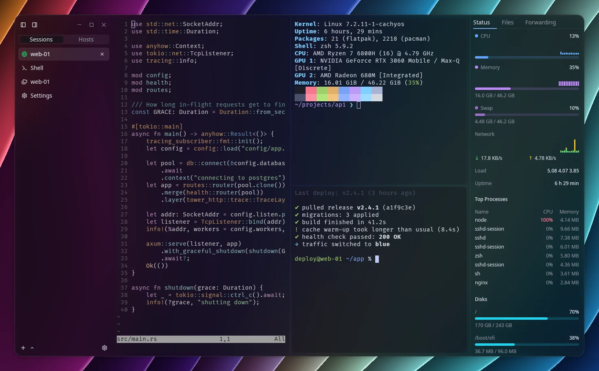
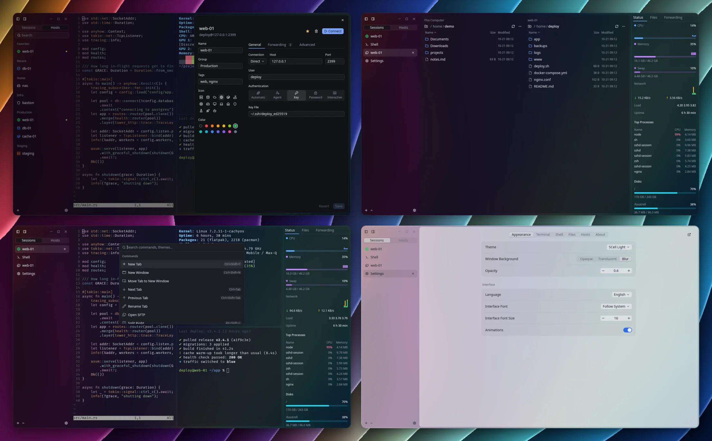

<p align="center">
  
</p>

<h1 align="center">SCell</h1>

<p align="center">More than fast: a clean, intuitive, all-in-one modern terminal</p>

<p align="center">
  <a href="https://github.com/Tailcoil/scell/actions/workflows/ci.yml"></a>
  <a href="https://github.com/Tailcoil/scell/releases/latest"></a>
  
  <a href="LICENSE"></a>
  <br>
  <a href="https://www.rust-lang.org"></a>
  <a href="https://www.gpui.rs"></a>
  <a href="https://github.com/longbridge/gpui-component"></a>
  <a href="https://github.com/alacritty/alacritty"></a>
  <a href="https://github.com/Eugeny/russh"></a>
</p>

<p align="center">
  <a href="https://github.com/Tailcoil/scell/releases/latest">Download</a> ·
  <a href="docs/configuration.md">Configuration</a> ·
  <a href="README.zh-CN.md">简体中文</a>
</p>



- SSH host manager with chained jump hosts
- Dual-pane SFTP with resumable transfers
- Agentless server monitoring
- Local, remote and SOCKS port forwarding
- GBK, Big5, Shift_JIS and other legacy encodings
- Vertical tabs and split panes



## Install

| System | Install |
|---|---|
| Windows | [`setup.exe`, portable `.zip`](https://github.com/Tailcoil/scell/releases/latest) |
| Debian, Ubuntu | [`.deb`](https://github.com/Tailcoil/scell/releases/latest) |
| Fedora | [`.rpm`](https://github.com/Tailcoil/scell/releases/latest) |
| Arch Linux | [`.pkg.tar.zst`](https://github.com/Tailcoil/scell/releases/latest/download/scell-bin-x86_64.pkg.tar.zst), install with `sudo pacman -U` |
| Nix | `nix run github:Tailcoil/scell` |
| Other Linux | [AppImage, `.tar.gz`](https://github.com/Tailcoil/scell/releases/latest) |

## Build

```bash
# Debian / Ubuntu
sudo apt install build-essential pkg-config libfontconfig-dev libfreetype-dev \
  libxkbcommon-dev libxkbcommon-x11-dev libxcb1-dev
cargo build --release
```

## License

[Apache-2.0](LICENSE). The Catppuccin theme uses the [Catppuccin](https://catppuccin.com) palette.
