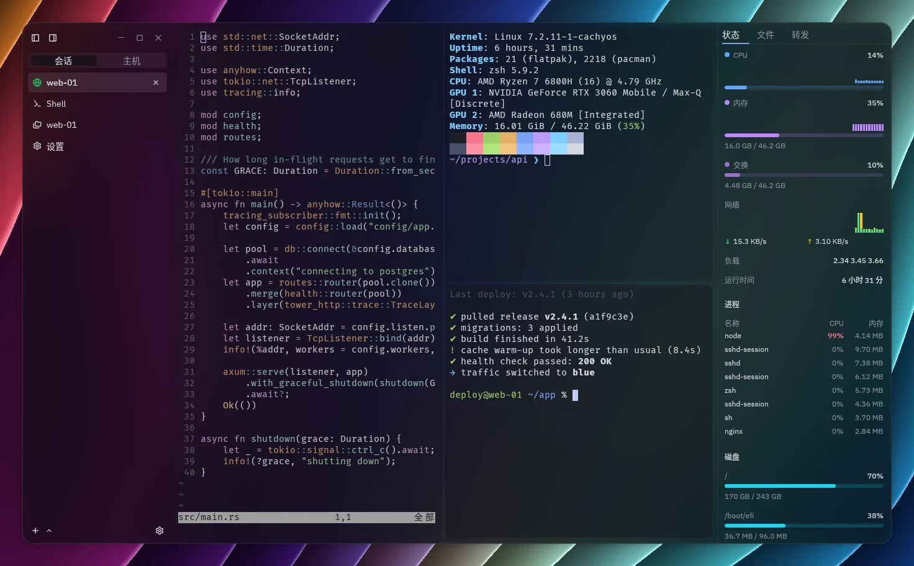
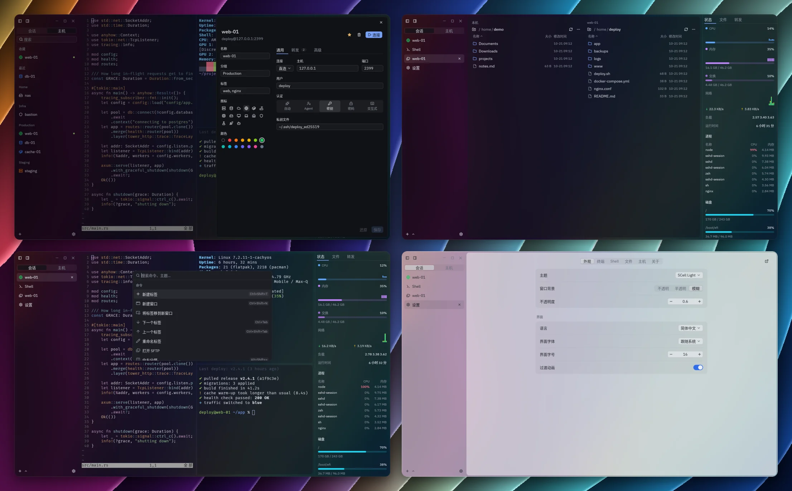

<p align="center">
  
</p>

<h1 align="center">SCell</h1>

<p align="center">不止于快，简洁、直观的一站式现代化终端</p>

<p align="center">
  <a href="https://github.com/Tailcoil/scell/actions/workflows/ci.yml"></a>
  <a href="https://github.com/Tailcoil/scell/releases/latest"></a>
  
  <a href="LICENSE"></a>
  <br>
  <a href="https://www.rust-lang.org"></a>
  <a href="https://www.gpui.rs"></a>
  <a href="https://github.com/longbridge/gpui-component"></a>
  <a href="https://github.com/alacritty/alacritty"></a>
  <a href="https://github.com/Eugeny/russh"></a>
</p>

<p align="center">
  <a href="https://github.com/Tailcoil/scell/releases/latest">下载</a> ·
  <a href="docs/configuration.zh-CN.md">配置</a> ·
  <a href="README.md">English</a>
</p>



- SSH 主机管理与多级跳板
- 双栏 SFTP 与断点续传
- 免安装的服务器监控
- 本地、远程与 SOCKS 端口转发
- GBK、Big5、Shift_JIS 等编码
- 竖排标签与分屏



## 安装

| 系统 | 安装 |
|---|---|
| Windows | [`setup.exe`、便携版 `.zip`](https://github.com/Tailcoil/scell/releases/latest) |
| macOS | [`.dmg`](https://github.com/Tailcoil/scell/releases/latest)，支持 Apple Silicon 与 Intel；未签名，首次打开需在“系统设置 → 隐私与安全性”中允许 |
| Debian、Ubuntu | [`.deb`](https://github.com/Tailcoil/scell/releases/latest) |
| Fedora | [`.rpm`](https://github.com/Tailcoil/scell/releases/latest) |
| Arch Linux | [`.pkg.tar.zst`](https://github.com/Tailcoil/scell/releases/latest/download/scell-bin-x86_64.pkg.tar.zst)，用 `sudo pacman -U` 安装 |
| Nix | `nix run github:Tailcoil/scell` |
| 其他 Linux | [AppImage、`.tar.gz`](https://github.com/Tailcoil/scell/releases/latest) |

## 构建

```bash
# Debian、Ubuntu
sudo apt install build-essential pkg-config libfontconfig-dev libfreetype-dev \
  libxkbcommon-dev libxkbcommon-x11-dev libxcb1-dev
# macOS：安装 Xcode
cargo build --release
```

## 许可证

[Apache-2.0](LICENSE)。Catppuccin 主题使用 [Catppuccin](https://catppuccin.com) 配色。
